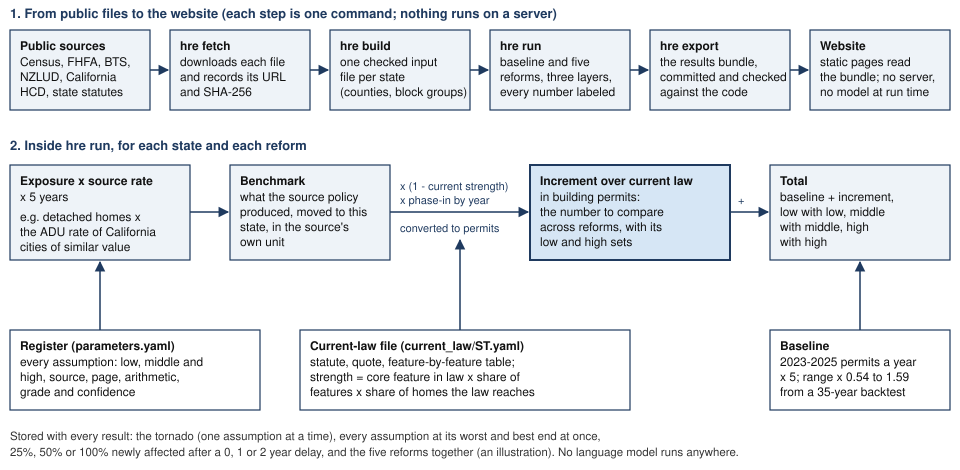

# Model & Assumptions Overview

Permit Horizon estimates how many more homes would get building permits over 2026-2030 if a state passed one of five housing reforms, compared with the laws it has today. It covers all 50 states and DC. This document says what the tool assumes, where each number comes from, and how far to trust it.

Every table inside a "generated" marker is written by `make docs` from the files the model itself reads (the assumption register, the state law files, the validation ledger and the committed results). A test fails if one of those tables drifts from its source, so the numbers here are the numbers the website shows. Everything else was written by the team.

# Purpose and Scope

**The question.** If a state passed a benchmark reform, how many more building permits for new homes would it see over the next five years than under current law, and how sure can anyone be?

**Who it's for.** State legislators and their staff, first. Analysts who want to check the work or run it for another state, second. The website explains every term in plain language and links each number to its source; this document and the methods notes in `docs/methods/` are the technical companion.

**Geography and time.** Every state and DC, built up from counties and reported as statewide totals. Five years, 2026 to 2030, as the challenge sets.

**The outcome: building permits for new homes.** We count housing units authorized by building permits, as the Census Bureau's Building Permits Survey reports them. We chose permits for three reasons:

1. It's the one annual series that covers every county in every state the same way, and at state level it goes back to 1980, which lets us test the baseline against 35 years of history.
2. A state reform changes the permission to build, and a permit is the first place that permission shows up.
3. Every source the model borrows from converts to permits with a stated factor (Census: about 100 houses, 92 homes of all kinds and 79 apartments are completed for every 100 permitted).

**The five reforms (all five are modeled).**

1. Accessory dwelling units (ADUs): one ADU allowed by right on every single-family lot.
2. Missing middle: two to six homes allowed on lots now limited to one house (the challenge's definition).
3. Transit-oriented density: more homes allowed near rail, streetcar, subway and ferry stops.
4. Parking: no minimum parking requirement for new homes.
5. Fees: development and impact fees cut by half, from the challenge's $50,000 a home to $25,000.

**Three layers for every reform.** Each reform comes out as three numbers, and each carries its unit (its outcome label) so that numbers in different units are never added or ranked together.

- The **benchmark** is what the reform produced where it was measured, moved to this state's homes and lots, in the source's own unit (completed ADUs, net permits, homes added to the stock, or cost-response permits).
- The **increment over current law** is the part of the benchmark that would be new here, given what the state's statutes already allow, phased in by year and converted to permits. This is the number to compare across reforms.
- The **total** is the baseline plus the increment, low with low, middle with middle and high with high.

**In scope:** statewide permit totals for 2026-2030 under each reform, with low, middle and high assumption sets; what current state law already provides; one assumption at a time and all at once; named what-if cases (25%, 50% or 100% of homes newly affected, starting after 0, 1 or 2 years); the five reforms together as an illustration.

**Out of scope:** which towns or lots will build; prices, rents, affordability, homelessness and who moves in; local ordinances; years after 2030; any probability attached to a range.

# Core Assumptions and Their Rationale

These eight assumptions carry the model. Each has a value, a range, a source and the arithmetic in the register (`src/hre/assumptions/parameters.yaml`); the table below lists every entry.

1. **Without a reform, the recent pace continues.** The baseline is each county's 2023-2025 average permits, by structure type, times five. A backtest on every state, for forecasts made from 1999 to 2020, picked the three-year average: it is within three points of the most accurate rule tried, and one odd year moves it a third as much as a one-year rule.
2. **A reform here produces what it produced where it was measured.** ADU rates come from California cities with similar home values; missing middle from Portland's first year; transit density from Los Angeles, with Chicago's zero as the low end. Parking and fees have no clean "reform passed, homes followed" study, so they go through a measured builder response to cost.
3. **What state law already allows is subtracted.** If a state's statutes already deliver part of a reform, only the rest counts as new. That share is the current strength, set from the statute itself (next section).
4. **Uptake takes time.** ADUs reach 25%, 40%, 55%, 70% and 85% of their full rate in years 1 to 5 at the middle. Missing middle and transit density use their source rate from year 1 at the middle (Portland's rate is its first year; the Los Angeles rate already averages six years) and Auckland's slower build-up in the low set.
5. **Geography decides who is exposed.** Missing middle counts single-family homes in the central counties of metropolitan areas only. Transit density counts homes in block groups whose center lies within half a mile of a rail, streetcar, subway or ferry stop. The parking response is halved outside those central counties at the middle.
6. **Prices scale borrowed rates, within limits.** For missing middle and transit density, a county with homes worth more than the source city gets a higher rate, by the square root of the value ratio, held between half and one and a half times the source rate.
7. **Builders respond to cost.** A 1% cut in the cost of a new home, relative to its price, adds 0% (low), 0.75% (middle) or 2.84% (high) to five years of building. The low end is the null result the fee literature actually reports.
8. **Low, middle and high are named assumption sets.** The sets move only the assumptions that carry each source's evidence range. The other assumptions are swung one at a time in the tornado and all together in the joint cases. No probability is attached to any range.

<!-- BEGIN generated:core-assumptions -->
| Assumption (used by; grade, confidence) | Low / middle / high | Why this value | Sources |
|---|---|---|---|
| **Time horizon** (all; R, set by rules) | 5 years (fixed) | The challenge fixes the horizon so results compare across teams. | [Housing Data and Technology Innovation Challenge, Participant Handbook](https://www.housingchallenge.turnout.rocks/handbook.html) |
| **Years averaged for the baseline** (baseline; R, moderate) | 3 years (fixed) | A short window tracks the current pace; three years dampens a single unusual year (a large apartment project, a storm rebuild). | [Permit Horizon baseline backtest (docs/evidence/baseline_backtest.md)](https://github.com/rmanacha/permit-horizon/blob/main/docs/evidence/baseline_backtest.md) |
| **Baseline band (share of past periods inside)** (baseline; A, moderate) | P10 of actual/forecast / point / P90 of actual/forecast | Percentiles of past errors are a statement about history that a reader can check; the band is state-level and applied to every county (county errors are larger; said on every page). | [Permit Horizon baseline backtest (docs/evidence/baseline_backtest.md, this document)](https://github.com/rmanacha/permit-horizon/blob/main/docs/evidence/baseline_backtest.md); [Census Building Permits Survey, state annual files 1980-2025](https://www2.census.gov/econ/bps/State/) |
| **Years of history for the 20-year swing band (shown beside the headline)** (baseline; R, moderate) | 10 years / 20 years / 30 years | Long enough to include past slow and fast building periods; each state's band reflects its own swings. | [Permit Horizon baseline backtest (docs/evidence/baseline_backtest.md), band rule B](https://github.com/rmanacha/permit-horizon/blob/main/docs/evidence/baseline_backtest.md); [Census Building Permits Survey, state annual files 1980-2025](https://www2.census.gov/econ/bps/State/) |
| **Completed homes per permitted home, single-family** (ADU, missing middle, transit, parking, fees; A, moderate) | 0.98 / 1.00 / 1.00 | Single-family permits almost all become homes, about a year later. | [Census Bureau, New Residential Construction, units completed in permit-issuing areas](https://www.census.gov/construction/nrc/xls/comps_permits_cust.xlsx); [Census Bureau, New Residential Construction, units authorized in permit-issuing places](https://www.census.gov/construction/nrc/xls/permits_cust.xlsx) |
| **Completed homes per permitted home, 2 to 4 units** (missing middle; B, low) | 0.88 / 0.92 / 0.92 | The all-structures ratio sits between 1-unit and 5+ and is immune to reclassification. | [Census Bureau, New Residential Construction, units completed in permit-issuing areas](https://www.census.gov/construction/nrc/xls/comps_permits_cust.xlsx); [Census Bureau, New Residential Construction, units authorized in permit-issuing places](https://www.census.gov/construction/nrc/xls/permits_cust.xlsx); [Census Bureau, Data Relationships between Permits, Starts, and Completions](https://www.census.gov/construction/pdf/nrc_relationships.pdf) |
| **Completed homes per permitted home, 5 or more units** (transit, parking, fees; A, moderate) | 0.75 / 0.79 / 0.79 | About a fifth of apartment permits are never built or are re-permitted. | [Census Bureau, New Residential Construction, units completed in permit-issuing areas](https://www.census.gov/construction/nrc/xls/comps_permits_cust.xlsx); [Census Bureau, New Residential Construction, units authorized in permit-issuing places](https://www.census.gov/construction/nrc/xls/permits_cust.xlsx) |
| **Builder response to lower costs** (parking, fees; B, low) | 0.00% per 1% / 0.75% per 1% / 2.84% per 1% | No study measures a cut near $25,000 per unit; the range runs from no response to a long-run supply response. | [Mayer and Somerville, Land use regulation and new construction, Regional Science and Urban Economics 30 (2000)](https://doi.org/10.1016/S0166-0462(00)00055-3); [Baum-Snow and Han, The Microgeography of Housing Supply, Journal of Political Economy 132(6), 2024](https://doi.org/10.1086/728110); [Census Bureau, Annual Estimates of Housing Units for the United States (NST-EST2025-HU)](https://www.census.gov/data/tables/time-series/demo/popest/2020s-total-housing-units.html) |
| **Housing supply elasticity, metro counties outside Saiz's sample** (parking, fees; B, moderate) | 0.6 / 1.75 / 3.0 | Metros outside the 95 largest are smaller and on average less constrained than the mean. | [Saiz, The Geographic Determinants of Housing Supply, Quarterly Journal of Economics 125(3), 2010](https://joeornstein.github.io/pols-4641/readings/Saiz%20-%202010%20-%20The%20Geographic%20Determinants%20of%20Housing%20Supply.pdf) |
| **Housing supply elasticity, non-metropolitan counties** (parking, fees; C, low) | 1.75 / 3.0 / 3.0 | Little land scarcity outside metros; the value only matters for the diagnostic. | [Saiz, The Geographic Determinants of Housing Supply, Quarterly Journal of Economics 125(3), 2010](https://joeornstein.github.io/pols-4641/readings/Saiz%20-%202010%20-%20The%20Geographic%20Determinants%20of%20Housing%20Supply.pdf) |
| **Price elasticity of housing demand** (parking, fees; B, moderate) | -0.3 / -0.65 / -1.0 | A more elastic demand passes more of a cost cut into quantity, so -1.0 is the high case. | [Albouy, Ehrlich and Liu, Housing Demand, Cost-of-Living Inequality, and the Affordability Crisis, NBER w22816](https://www.nber.org/system/files/working_papers/w22816/w22816.pdf) |
| **Price change per dollar of fee** (parking, fees; B, moderate) | 1.00 / 1.20 / 1.66 | Builders mark fees up with financing and margin; at least full pass-through is the norm in the studies. | [UCLA Lewis Center and California YIMBY, The Impact of Fees on Housing (2024), literature review](https://cayimby.org/wp-content/uploads/2024/06/TheImpactofFees-Report-v3.pdf) |
| **Share of the long-run response that arrives within five years** (parking, fees; C, low) | 50% / 75% / 100% | Projects started in year 4 or 5 finish after the horizon. | [Topel and Rosen, Housing Investment in the United States, Journal of Political Economy 96(4), 1988 (via evidence_base.md section 6)](https://doi.org/10.1086/261562) |
| **New home price compared with the median home value** (parking, fees; A, moderate) | 1.00 / 1.25 / 1.57 | New homes sell for more than the typical owned home; the national ratio converts each state's median home value to a new home price. | [Census Bureau, Highlights of 2025 Characteristics of New Housing](https://www.census.gov/construction/chars/highlights.html); [ACS 2020-2024 five-year, table B25077, United States](https://data.census.gov/table/ACSDT5Y2024.B25077) |
| **Published stock supply elasticity (diagnostic only)** (fees; B, moderate) | 0.3 (fixed) | Use a stock elasticity with a stock denominator in the diagnostic. | [Baum-Snow and Han, The Microgeography of Housing Supply, Journal of Political Economy 132(6), 2024](https://doi.org/10.1086/728110) |
| **Five-year realization share for the stock diagnostic** (fees; C, low) | 0.5 (fixed) | Hold the inherited assumption constant to isolate the stock-versus-flow denominator difference. | [Adam Ruege, Housing Reform Estimator v2.0, assumptions/fees.yaml (inherited assumption)](https://github.com/rmanacha/permit-horizon/blob/main/docs/methods/builder_response.md) |
| **U.S. housing-unit growth, July 2020 to July 2025** (fees; A, high) | 5.29% (fixed) | Converts a stock response into percent of five years' construction. | [Census Bureau, Annual Estimates of Housing Units for the United States (NST-EST2025-HU)](https://www.census.gov/data/tables/time-series/demo/popest/2020s-total-housing-units.html) |
| **Total development fees per unit** (fees; R, set by rules) | $50,000 (fixed) | Fixed by the challenge so results compare across teams. | [Housing Data and Technology Innovation Challenge, Participant Handbook](https://www.housingchallenge.turnout.rocks/handbook.html) |
| **Fee cut** (fees; R, set by rules) | 50% (fixed) | Fixed by the challenge. | [Housing Data and Technology Innovation Challenge, Participant Handbook](https://www.housingchallenge.turnout.rocks/handbook.html) |
| **Price adjustment exponent (gamma)** (missing middle, transit; C, low) | 0 (no adjustment) / 0.5 / 1.0 | Upzoning yields more where homes are worth more; the exponent keeps that with one number whose low case is "none". | [Monkkonen, Manville and Lens, Built out cities? A new approach to measuring land use regulation, Journal of Housing Economics (2024)](https://pmc.ncbi.nlm.nih.gov/articles/PMC12308518/) |
| **ADU ramp, share of the steady-state rate in years 1 to 5** (ADU; B, low) | 12/21/36/38/59% / 25/40/55/70/85% / 50/80/100/100/100% | Uptake builds as owners learn the rules, lenders adapt and plans are pre-approved. | [California HCD APR Table A2 (ADU rows) and HCD ADU handbook](https://data.ca.gov/dataset/housing-element-annual-progress-report-apr-data-by-jurisdiction-and-year); [Seattle OPCD ADU Annual Report 2024](https://www.seattle.gov/documents/Departments/OPCD/OngoingInitiatives/EncouragingBackyardCottages/OPCD-ADUAnnualReport2024.pdf) |
| **No ramp (source rate from year 1)** (ADU, missing middle, transit, parking, fees; R, set by rules) | 100% from year 1 (fixed) | The simplest case a legislator can check by hand. | [Adam Ruege, Housing Reform Estimator v2.0, policy cases](https://github.com/rmanacha/permit-horizon/blob/main/docs/methods/cases.md) |
| **Home value tier 1 upper bound** (ADU; R, high) | $430,100 (fixed) | Five groups of about 91 cities by home value. | [California HCD Annual Progress Report Table A2 (ADU rows), de-duplicated](https://data.ca.gov/dataset/housing-element-annual-progress-report-apr-data-by-jurisdiction-and-year); [ACS 2020-2024 five-year, tables B25077 (median value) and B25024 (units in structure), California places](https://www2.census.gov/programs-surveys/acs/summary_file/2024/table-based-SF/); [Permit Horizon ADU tier calibration (docs/evidence/adu_tiers.md)](https://github.com/rmanacha/permit-horizon/blob/main/docs/evidence/adu_tiers.md) |
| **Home value tier 2 upper bound** (ADU; R, high) | $618,840 (fixed) | Five groups of about 91 cities by home value. | [California HCD Annual Progress Report Table A2 (ADU rows), de-duplicated](https://data.ca.gov/dataset/housing-element-annual-progress-report-apr-data-by-jurisdiction-and-year); [ACS 2020-2024 five-year, tables B25077 (median value) and B25024 (units in structure), California places](https://www2.census.gov/programs-surveys/acs/summary_file/2024/table-based-SF/); [Permit Horizon ADU tier calibration (docs/evidence/adu_tiers.md)](https://github.com/rmanacha/permit-horizon/blob/main/docs/evidence/adu_tiers.md) |
| **Home value tier 3 upper bound** (ADU; R, high) | $825,060 (fixed) | Five groups of about 91 cities by home value. | [California HCD Annual Progress Report Table A2 (ADU rows), de-duplicated](https://data.ca.gov/dataset/housing-element-annual-progress-report-apr-data-by-jurisdiction-and-year); [ACS 2020-2024 five-year, tables B25077 (median value) and B25024 (units in structure), California places](https://www2.census.gov/programs-surveys/acs/summary_file/2024/table-based-SF/); [Permit Horizon ADU tier calibration (docs/evidence/adu_tiers.md)](https://github.com/rmanacha/permit-horizon/blob/main/docs/evidence/adu_tiers.md) |
| **Home value tier 4 upper bound** (ADU; R, high) | $1,160,300 (fixed) | Five groups of about 91 cities by home value. | [California HCD Annual Progress Report Table A2 (ADU rows), de-duplicated](https://data.ca.gov/dataset/housing-element-annual-progress-report-apr-data-by-jurisdiction-and-year); [ACS 2020-2024 five-year, tables B25077 (median value) and B25024 (units in structure), California places](https://www2.census.gov/programs-surveys/acs/summary_file/2024/table-based-SF/); [Permit Horizon ADU tier calibration (docs/evidence/adu_tiers.md)](https://github.com/rmanacha/permit-horizon/blob/main/docs/evidence/adu_tiers.md) |
| **ADU completions per detached home per year, tier 1 (median value 0 to $430,100)** (ADU; B, moderate) | 0.011% / 0.062% / 0.132% | Under the same state law, California cities where homes are worth more completed more ADUs per detached home. | [California HCD Annual Progress Report Table A2 (ADU rows), de-duplicated](https://data.ca.gov/dataset/housing-element-annual-progress-report-apr-data-by-jurisdiction-and-year); [ACS 2020-2024 five-year, tables B25077 (median value) and B25024 (units in structure), California places](https://www2.census.gov/programs-surveys/acs/summary_file/2024/table-based-SF/); [Permit Horizon ADU tier calibration (docs/evidence/adu_tiers.md)](https://github.com/rmanacha/permit-horizon/blob/main/docs/evidence/adu_tiers.md) |
| **ADU completions per detached home per year, tier 2 (median value $430,100 to $618,840)** (ADU; B, moderate) | 0.056% / 0.159% / 0.455% | Under the same state law, California cities where homes are worth more completed more ADUs per detached home. | [California HCD Annual Progress Report Table A2 (ADU rows), de-duplicated](https://data.ca.gov/dataset/housing-element-annual-progress-report-apr-data-by-jurisdiction-and-year); [ACS 2020-2024 five-year, tables B25077 (median value) and B25024 (units in structure), California places](https://www2.census.gov/programs-surveys/acs/summary_file/2024/table-based-SF/); [Permit Horizon ADU tier calibration (docs/evidence/adu_tiers.md)](https://github.com/rmanacha/permit-horizon/blob/main/docs/evidence/adu_tiers.md) |
| **ADU completions per detached home per year, tier 3 (median value $618,840 to $825,060)** (ADU; B, moderate) | 0.119% / 0.244% / 0.421% | Under the same state law, California cities where homes are worth more completed more ADUs per detached home. | [California HCD Annual Progress Report Table A2 (ADU rows), de-duplicated](https://data.ca.gov/dataset/housing-element-annual-progress-report-apr-data-by-jurisdiction-and-year); [ACS 2020-2024 five-year, tables B25077 (median value) and B25024 (units in structure), California places](https://www2.census.gov/programs-surveys/acs/summary_file/2024/table-based-SF/); [Permit Horizon ADU tier calibration (docs/evidence/adu_tiers.md)](https://github.com/rmanacha/permit-horizon/blob/main/docs/evidence/adu_tiers.md) |
| **ADU completions per detached home per year, tier 4 (median value $825,060 to $1,160,300)** (ADU; B, moderate) | 0.157% / 0.256% / 0.483% | Under the same state law, California cities where homes are worth more completed more ADUs per detached home. | [California HCD Annual Progress Report Table A2 (ADU rows), de-duplicated](https://data.ca.gov/dataset/housing-element-annual-progress-report-apr-data-by-jurisdiction-and-year); [ACS 2020-2024 five-year, tables B25077 (median value) and B25024 (units in structure), California places](https://www2.census.gov/programs-surveys/acs/summary_file/2024/table-based-SF/); [Permit Horizon ADU tier calibration (docs/evidence/adu_tiers.md)](https://github.com/rmanacha/permit-horizon/blob/main/docs/evidence/adu_tiers.md) |
| **ADU completions per detached home per year, tier 5 (median value $1,160,300 and above)** (ADU; B, moderate) | 0.132% / 0.271% / 0.379% | Under the same state law, California cities where homes are worth more completed more ADUs per detached home. | [California HCD Annual Progress Report Table A2 (ADU rows), de-duplicated](https://data.ca.gov/dataset/housing-element-annual-progress-report-apr-data-by-jurisdiction-and-year); [ACS 2020-2024 five-year, tables B25077 (median value) and B25024 (units in structure), California places](https://www2.census.gov/programs-surveys/acs/summary_file/2024/table-based-SF/); [Permit Horizon ADU tier calibration (docs/evidence/adu_tiers.md)](https://github.com/rmanacha/permit-horizon/blob/main/docs/evidence/adu_tiers.md) |
| **ADU permits per completed ADU (converts the ADU benchmark to permits)** (ADU; B, low) | 1.00 (all permits built) / 1.18 (2-year lag) / 1.40 (1-year lag) | The tier rates count completed ADUs; the headline counts permits, and some permits are never built. | [California HCD APR Table A2, ADU rows, de-duplicated (data/processed/CA_hcd_adu.json)](https://data.ca.gov/dataset/housing-element-annual-progress-report-apr-data-by-jurisdiction-and-year); [Terner Center, Reaching California's ADU Potential (2020)](https://ternercenter.berkeley.edu/wp-content/uploads/pdfs/Reaching_Californias_ADU_Potential_2020.pdf) |
| **Seattle ADU plateau (high overlay, central metropolitan counties)** (ADU; A, moderate) | 5.8 per 1,000 (fixed) | A dense central city with pre-approved plans and an active program; the upper end of measured uptake. | [Seattle OPCD, ADU Annual Report 2024](https://www.seattle.gov/documents/Departments/OPCD/OngoingInitiatives/EncouragingBackyardCottages/OPCD-ADUAnnualReport2024.pdf) |
| **Maine first-year ADU rate (low overlay)** (ADU; B, low) | 0.95 per 1,000 (fixed) | A statewide law in a low-price, rural state in its first year; the low end of measured uptake. | [Maine State Housing Authority, housing data blog on 2025 permits](https://www.mainestatehousingdata.org/permits/blog) |
| **Missing-middle units permitted per single-family lot each year** (missing middle; B, low) | 0 (stress case) / 0.17 per 100 lots (Portland net) / 0.40 per 100 lots (Portland R2.5 gross) | Preserve the permit stage and distinguish known demolition subtraction from a gross-permit ceiling. | [City of Portland, Residential Infill Project Year-One Report (June 2023)](https://www.portland.gov/bps/planning/rip/news/2023/7/5/new-study-shows-promising-housing-production-results-residential); [City of Portland, Middle Housing in the Single-Dwelling Zones Progress Report 2018-2024 (January 2025)](https://www.sightline.org/wp-content/uploads/2025/02/Monitoring-reports-Middle-Housing-in-the-Single-Dwelling-Zones-Progress-Report-2018-2024-January-2025.pdf) |
| **Share of single-family lots zoned for single-family homes only** (missing middle; C, low) | 70% / 80% / 90% | Lots already zoned for more homes are not newly affected by a middle-housing law. | [Mleczko and Desmond, National Zoning and Land Use Database (NZLUD), nzlud_muni.csv and data dictionary](https://github.com/mtmleczko/nzlud) |
| **Net new homes per gross permitted unit (applied to the gross high rate)** (missing middle; B, low) | 0.69 (Arlington) / 0.76 / 0.83 (Portland) | Middle housing often replaces an existing house; the gross count overstates the addition. | [Arlington County, Expanded Housing Option Annual Data Report (March 2026)](https://www.arlingtonva.us/files/sharedassets/public/v/1/housing/documents/missing-middle/eho-annual-data-report-march-2026.pdf); [City of Portland, Residential Infill Project Year-One Report (June 2023)](https://www.portland.gov/bps/planning/rip/news/2023/7/5/new-study-shows-promising-housing-production-results-residential) |
| **Building-code penalty for three or more units** (missing middle; C, low) | 0.8 / 0.9 / 1.0 (no penalty) | The source rate came from a place under a similar code, so the penalty is small and its high end is none. | [Terner Center, Missing Middle Development Math (June 2024) and construction-cost figures (2023 dollars)](https://ternercenter.berkeley.edu/wp-content/uploads/2024/06/Missing-Middle-Development-Math-Final-June-2024.pdf); [Arlington County, Expanded Housing Option Annual Data Report (March 2026)](https://www.arlingtonva.us/files/sharedassets/public/v/1/housing/documents/missing-middle/eho-annual-data-report-march-2026.pdf) |
| **Median home value in the missing-middle source city (Portland, OR)** (missing middle; A, high) | $581,500 (fixed) | The rate was measured in Portland; places where homes are worth less get less of it. | [ACS 5-year 2020-2024, table B25077, Portland city, Oregon (place 4159000)](https://www2.census.gov/programs-surveys/acs/summary_file/2024/table-based-SF/data/5YRData/acsdt5y2024-b25077.dat) |
| **Median home value in the TOD source city (Los Angeles)** (transit; A, high) | $921,200 (fixed) | The rate was measured in Los Angeles; places where homes are worth less get less of it. | [ACS 5-year 2020-2024, table B25077, Los Angeles city, California (place 0644000)](https://www2.census.gov/programs-surveys/acs/summary_file/2024/table-based-SF/data/5YRData/acsdt5y2024-b25077.dat) |
| **Bounds on the market adjustment** (missing middle, transit; R, set by rules) | x0.5 floor / 1.0 / x1.5 cap | Keeps the price scaling from overriding the measured rate. | [Permit Horizon method note, missing middle (market adjustment, a team convention)](https://github.com/rmanacha/permit-horizon/blob/main/docs/methods/missing_middle.md) |
| **Missing-middle ramp, share of the source rate in years 1 to 5** (missing middle; B, low) | 13/37/50/67/100% (Auckland) / 100% from year 1 / 100% from year 1 | A first-year rate already includes the start-up period. | [Greenaway-McGrevy and Phillips, The impact of upzoning on housing construction in Auckland, Journal of Urban Economics (2023)](https://gwern.net/doc/economics/georgism/2023-greenawaymcgrevy.pdf) |
| **Whole-area housing response each year per home near transit** (transit; B, low) | 0 (Chicago) / 0.012 per 100 homes (Kestelman LA) / 0.133 per 100 homes (Stacy et al.) | Applications rose sharply in Los Angeles but supply did not (Kestelman), so the middle is small. | [Kestelman, Effects of Transit-Oriented Incentive Programs, Harvard JCHS working paper (May 2025)](https://www.jchs.harvard.edu/research-areas/working-papers/effects-transit-oriented-incentive-programs-evidence-los-angeles); [Stacy and others, Urban Studies (2023)](https://doi.org/10.1177/00420980231159500); [Freemark, Upzoning Chicago, Urban Affairs Review (2020)](https://yonahfreemark.com/wp-content/uploads/2019/01/Freemark-Upzoning-Chicago.pdf) |
| **Distance from a major transit stop** (transit; R, high) | 0.25 miles / 0.5 miles / 0.5 miles | Half a mile is the distance most US transit zoning laws use and the distance at which the rates were measured. | [Massachusetts General Laws chapter 40A section 3A](https://malegislature.gov/Laws/GeneralLaws/PartI/TitleVII/Chapter40A/Section3A); [California SB 79 summary (MTC, April 2026)](https://mtc.ca.gov/sites/default/files/documents/2026-04/SB79-Summary-040826_0.pdf) |
| **TOD ramp, share of the source rate in years 1 to 5** (transit; B, low) | 13/37/50/67/100% (Auckland) / 100% from year 1 / 100% from year 1 | An average over the program's first years already includes the start-up period. | [Greenaway-McGrevy and Phillips, Journal of Urban Economics (2023)](https://gwern.net/doc/economics/georgism/2023-greenawaymcgrevy.pdf) |
| **Parking spaces required per home before the reform (fallback)** (parking; B, moderate) | 1 per home (fixed) | One space per home is the minimum in the cities the parking evidence comes from. | [UCLA Center for Parking Policy, The Impacts of Minimum Parking Requirements, A Research Synthesis (February 2026)](https://www.its.ucla.edu/publication/impacts-minimum-parking-requirements-research-synthesis) |
| **Parking builders still provide, as a share of the former minimum** (parking; B, moderate) | 60% / 79% / 100% | A statewide reform covers mostly places less dense than Seattle's urban villages, so Buffalo's citywide result is the middle. | [UCLA Center for Parking Policy, The Impacts of Minimum Parking Requirements, A Research Synthesis (February 2026)](https://www.its.ucla.edu/publication/impacts-minimum-parking-requirements-research-synthesis) |
| **Construction cost per parking space** (parking; B, moderate) | $29,000 / $52,000 / $73,000 | Minimums bind mainly where parking is built in structures, so the spaces left unbuilt are mostly structured. | [UCLA ITS, No Such Thing as Free Parking, Construction Costs in 17 U.S. Cities (Schwartz, February 2026)](https://www.its.ucla.edu/publication/no-such-thing-as-free-parking/) |
| **Share of the parking response outside central metropolitan counties** (parking; C, low) | 0 (no response) / 50% / 100% (same as central) | Parking minimums bind where land is dear; elsewhere builders supply the parking anyway. | [Sohoni and Lee, Parking the Minimum Parking Requirement, Evidence from Nine U.S. Cities, Journal of Planning Education and Research 46(1), 2026 (online June 2025)](https://doi.org/10.1177/0739456X251343047) |
| **Typical actual impact fee per single-family home (variant)** (fees; B, low) | $13,627 (fixed) | Shows how the answer changes when the cut is half of a typical fee rather than half of $50,000. | [NAHB, Impact Fee Primer (citing Duncan Associates' 2019 national survey)](https://www.nahb.org/-/media/NAHB/advocacy/docs/industry-issues/land-use-101/infrastructure/impact-fee-primer.pdf) |
| **Missing-middle units per redeveloped lot (combined package only)** (missing middle, ADU; B, moderate) | 3.35 (fixed) | A lot redeveloped as a triplex or fourplex is no longer a candidate for a backyard ADU. | [City of Portland, Residential Infill Project Year-One Report (June 2023)](https://www.portland.gov/bps/planning/rip/news/2023/7/5/new-study-shows-promising-housing-production-results-residential) |
| **Minneapolis gross permitted activity (diagnostic only)** (missing middle; B, low) | 0.000628 (fixed) | Gross permits on all parcels cannot establish a low bound for net additional homes. | [Federal Reserve Bank of Minneapolis, Minneapolis 2040 Plan indicators point to stable rents, stalled development (2026)](https://www.minneapolisfed.org/article/2026/minneapolis-2040-plan-indicators-point-to-stable-rents-stalled-development) |
| **Spokane, Austin and Charlotte middle-housing rates (diagnostic only)** (missing middle; C, low) | 1.8 per 1,000 / 1.9 per 1,000 / 2.0 per 1,000 | A second cluster of cities, kept as a check on the Portland rate. | [Spokane Journal of Business, Missing middle housing gains traction in Spokane](https://www.spokanejournal.com/articles/18294-missing-middle-housing-gains-traction-in-spokane); [City of Austin, HOME initiative memo (November 2025)](https://services.austintexas.gov/edims/document.cfm?id=463145) |
| **Arlington completed or under-construction middle housing (diagnostic only)** (missing middle; B, low) | 0.26 per 1,000 (fixed) | Shows how far approvals can sit from homes built. | [Arlington County, Expanded Housing Option Annual Data Report (March 2026)](https://www.arlingtonva.us/files/sharedassets/public/v/1/housing/documents/missing-middle/eho-annual-data-report-march-2026.pdf) |
| **Local transit-boundary response (diagnostic only)** (transit; B, low) | 0.003378 (fixed) | Keep local reallocation separate from the statewide evidence. | [Kestelman, Effects of Transit-Oriented Incentive Programs, Harvard JCHS working paper (May 2025)](https://www.jchs.harvard.edu/research-areas/working-papers/effects-transit-oriented-incentive-programs-evidence-los-angeles) |

55 entries. The page, table or paragraph each value comes from, and the arithmetic word for word, are in the full register ([docs/methods/register.md](methods/register.md)) and on the website's Assumptions and data page.
<!-- END generated:core-assumptions -->

## What state law already does

A reform's increment depends on how much of it a state already has. We filed each state's statutes in `src/hre/current_law/{ST}.yaml`: the citation, a quote checked against the official page, and a feature-by-feature comparison with the benchmark. The strength is three factors a reader can check against the statute and the Census:

    strength = core feature in law (1 or 0) × share of benchmark features in law × share of the state's detached homes the law reaches

The core feature is the one that makes the reform real (for ADUs, towns must allow one per lot). A law that only lets towns act scores 0. A feature that takes effect inside 2026-2030 counts for the share of the five years it is in force. Arizona's ADU law has all four features but exempts towns of 75,000 people or fewer, so it reaches 80% of the state's detached homes and its strength is 0.80.

All 399 quotes were checked against their pages: 354 by a script anyone can rerun (`make law-check`) and 45 by hand on sites that refuse scripts, each with the date and method recorded. A person on the team signs each record's human review; the tables show which are still pending.

ADUs, every state and DC:

<!-- BEGIN generated:current-law-adu -->
| State | Strength (newly affected) | Benchmark features in law (core feature) | Detached homes the law reaches | Statute |
|---|---|---|---|---|
| California | 1.00 (0%) | 4 of 4 (core: yes) | 100% | California Government Code 66310 to 66342, mainly 66314, 66321, 66322 and 66323, renumbered by S.B. 477 (2024, chapter 7) and amended by A.B. 2533 (2024, chapter 834), S.B. 1211 (2024, chapter 296) and S.B. 543 (2025, chapter 520), among others |
| District of Columbia | 1.00 (0%) | 4 of 4 (core: yes) | 100% | Zoning Regulations of 2016, 11-U DCMR section 253 (accessory apartments), adopted by Z.C. Order No. 08-06A (63 DCR 2447, March 4, 2016) and amended by Z.C. Order No. 18-16/19-27 (70 DCR 11297, August 25, 2023); with 11-D DCMR 201.1, 5002 and 5003 and 11-C DCMR 701.5 |
| Iowa | 1.00 (0%) | 4 of 4 (core: yes) | 100% | Iowa Code 364.3(23) (cities) and 331.301(29) (counties), added by S.F. 592 (2025 Iowa Acts chapter 38) and amended by S.F. 2369 (2026 Iowa Acts chapter 1013) |
| Arizona | 0.80 (20%) | 4 of 4 (core: yes) | 80% | A.R.S. 9-461.18 (cities and towns of more than 75,000 people), enacted by H.B. 2720 (2024, chapter 196) and amended by H.B. 2928 (2025, chapter 217); A.R.S. 11-810.01 (counties), added by H.B. 2928 |
| Maine | 0.75 (25%) | 3 of 4 (core: yes) | 100% | 30-A M.R.S. 4364-B, enacted by L.D. 2003 (Public Law 2021, chapter 672, section 6, signed April 27, 2022); amended by L.D. 1706 (Public Law 2023, chapter 192), L.D. 1829 (Public Law 2025, chapter 385) and L.D. 2173 (Public Law 2025, chapter 733, signed April 16, 2026) |
| New Hampshire | 0.75 (25%) | 3 of 4 (core: yes) | 100% | RSA 674:71 to 674:73, as amended by H.B. 577 (2025, chapter 197) and H.B. 1079 (2026, chapter 210); first enacted by S.B. 146 (2016, chapter 6) |
| Vermont | 0.75 (25%) | 3 of 4 (core: yes) | 100% | 24 V.S.A. 4412(1)(E) and 4303(38), as amended by S.237 (2020, Act 179), S.100 (2023, Act 47) and S.328 (2026, Act 179) |
| Massachusetts | 0.73 (27%) | 3 of 4 (core: yes) | 98% | General Laws chapter 40A, section 3 (protected ADU use) and section 1A (definition), as amended by sections 7 and 8 of Chapter 150 of the Acts of 2024 (H. 4977, the Affordable Homes Act) |
| Arkansas | 0.65 (35%) | 4 of 4 (from 2026-01-01) (core: yes) | 65% | Arkansas Code 14-56-205, added by H.B. 1503 (2025, Act 313) |
| Colorado | 0.63 (37%) | 4 of 4 (core: yes) | 63% | C.R.S. title 29, article 35 (accessory dwelling units; the requirements are at 29-35-403 as codified), added by H.B. 24-1152 (2024, Session Laws chapter 167), which numbers the sections 29-35-101 to 29-35-105 |
| Oregon | 0.56 (44%) | 3 of 4 (core: yes) | 74% | ORS 197A.425 (formerly ORS 197.312(5) and (6)), enacted by S.B. 1051 (2017, chapter 745) and amended by H.B. 2001 (2019, chapter 639) and H.B. 2347 (2025, chapter 38) |
| Washington | 0.54 (46%) | 3 of 4 (core: yes) | 72% | RCW 36.70A.680 and 36.70A.681, enacted by H.B. 1337 (2023, chapter 334); RCW 36.70A.680 amended by S.S.B. 5558 (2025, chapter 148) |
| Rhode Island | 0.50 (50%) | 2 of 4 (core: yes) | 100% | R.I. Gen. Laws 45-24-37(e) and 45-24-73, as amended by H 7062 Sub A and S 2998 Sub A (2024, Public Laws chapters 284 and 285); 45-24-73 first enacted by Public Laws 2022, chapters 437 and 440 |
| Utah | 0.50 (50%) | 2 of 4 (core: yes) | 100% | Utah Code 10-21-303 (cities and towns) and 17-80-303 (counties), internal ADUs, first enacted by H.B. 82 (2021); detached ADUs on large lots, Utah Code 10-21-304, enacted by S.B. 284 (2026, chapter 166) |
| Montana | 0.49 (51%) | 4 of 4 (core: yes) | 49% | MCA 76-2-345 (cities and towns), enacted by S.B. 528 (2023, chapter 502); MCA 76-2-215 (counties with zoning), enacted by S.B. 532 (2025, chapter 619) |
| Nevada | 0.38 (62%) | 2 of 4 (from 2026-07-01) (core: yes) | 85% | NRS 278.257, added by A.B. 396 (2025, Statutes of Nevada chapter 365); the deadline and fallback are in section 11 of the act |
| Virginia | 0.35 (65%) | 2 of 4 (from 2027-07-01) (core: yes) | 100% | Va. Code 15.2-2292.4 (development and use of accessory dwelling units), enacted by S.B. 531 (2026, chapter 895) |
| Idaho | 0.31 (69%) | 3 of 4 (from 2027-02-01) (core: yes) | 53% | Idaho Code 67-6541, added by S.B. 1354 (2026, Session Law chapter 265) |
| West Virginia | 0.28 (72%) | 4 of 4 (from 2027-01-01) (core: yes) | 36% | W. Va. Code 8-42-1 to 8-42-3 (enacted as 8-40-1 to 8-40-3 and redesignated), by S.B. 659 (2026, chapter 241, Acts of the Regular Session) |
| North Carolina | 0.22 (78%) | 4 of 4 (from 2027-01-15) (core: yes) | 27% | G.S. 160D-917 (accessory dwelling units), enacted by S.B. 445 (2025 session), Session Law 2026-59, section 44, ratified August 6, 2026 and signed August 11, 2026 |
| Connecticut | 0.21 (79%) | 3 of 4 (from 2026-07-01) (core: yes) | 29% | General Statutes 8-2o, enacted by Public Act 21-29, section 6 (H.B. 6107, 2021) and amended by November Special Session Public Act 25-1 (H.B. 8002, 2025) and Public Act 26-7 (H.B. 5288, 2026); parking: General Statutes 8-3n, enacted by November Special Session Public Act 25-1, section 19 |
| Hawaii | 0.20 (80%) | 1 of 4 (from 2026-12-31) (core: yes) | 100% | HRS 46-4.8, added by S.B. 3202 (2024), Act 39, Session Laws of Hawaii 2024 |
| Delaware | 0.00 (100%) | 0 of 4 (core: no) | 100% | 29 Del. C. 9220 to 9224 (Affordable Housing Act), added by Senate Substitute 2 for Senate Bill 23 (2026), the Housing for Every Delawarean Act, 85 Del. Laws chapter 343 |
| Florida | 0.00 (100%) | 0 of 4 (core: no) | 100% | Florida Statutes 163.31771 (accessory dwelling units), first enacted by chapter 2004-372, Laws of Florida, last amended by chapter 2020-27 |
| Indiana | 0.00 (100%) | 0 of 4 (core: no) | 100% | IC 36-7-4.3-3 (public hearing to review local zoning for more housing) and IC 36-7-1-1.5 (definition of accessory dwelling unit), added by House Enrolled Act 1001 (2026), Public Law 73-2026; no statewide requirement to allow ADUs |
| Kansas | 0.00 (100%) | 0 of 4 (core: no) | 100% | K.S.A. 2026 Supp. 12-776 (the by-right housing development act), enacted by S.B. 418 (2026, Session Laws chapter 76), section 1 |
| Maryland | 0.00 (100%) | 0 of 4 (core: no) | 100% | Maryland Land Use Article 4-501 to 4-504, added by H.B. 1466 (2025, chapter 197) and applied to charter counties by Land Use 1-401(b) and to Baltimore City by Land Use 10-103(b) |

22 jurisdictions have part of the ADU benchmark in state law; 5 have an ADU statute whose core feature (towns must allow one ADU per lot) is not required, so their strength is 0; 24 have no statewide ADU requirement (strength 0, the whole benchmark counts as new): Alaska, Alabama, Georgia, Illinois, Kentucky, Louisiana, Michigan, Minnesota, Missouri, Mississippi, North Dakota, Nebraska, New Jersey, New Mexico, New York, Ohio, Oklahoma, Pennsylvania, South Carolina, South Dakota, Tennessee, Texas, Wisconsin, Wyoming.
<!-- END generated:current-law-adu -->

All five reforms in the three showcase states:

<!-- BEGIN generated:current-law-showcase -->
**Utah**

| Reform | Statute | Benchmark features in law | Coverage | Strength | Newly affected | Human review |
|---|---|---|---|---|---|---|
| ADUs | Utah Code 10-21-303 (cities and towns) and 17-80-303 (counties), internal ADUs, first enacted by H.B. 82 (2021); detached ADUs on large lots, Utah Code 10-21-304, enacted by S.B. 284 (2026, chapter 166) | one ADU per lot: yes; detached and attached: no; 600 sq ft: yes; no added parking: no | 100% | 0.50 | 50% | pending |
| Missing middle | No statewide middle-housing requirement found. Nearest: Utah Code 10-21-201 (moderate income housing plans), whose menu of strategies includes rezoning for higher density. | single-family lots: no; two to six homes: no; three stories: no; setbacks fit: unknown | 100% | 0.00 | 100% | pending |
| Transit-oriented density | Utah Code 63N-23-104 (station area plans), first enacted by H.B. 462 (2022); station area defined in Utah Code 10-21-101 | more density: no; stops defined: yes; less parking: no | 100% | 0.00 | 100% | pending |
| No parking minimums | No statewide cap or repeal of residential parking minimums. Nearest: Utah Code 10-20-618 (parking space size and garages, as amended by S.B. 181, 2025) and the parking option in Utah Code 10-21-201. | minimums cut: no; provision: unknown | 100% | 0.00 | 100% | pending |
| Fees cut in half | Utah Code 11-36a (Impact Fees Act), section 11-36a-202 (prohibited impact fees) | $50,000 level: unknown; fees cut 50%: no; all categories: no | 100% | 0.00 | 100% | pending |

**New Hampshire**

| Reform | Statute | Benchmark features in law | Coverage | Strength | Newly affected | Human review |
|---|---|---|---|---|---|---|
| ADUs | RSA 674:71 to 674:73, as amended by H.B. 577 (2025, chapter 197) and H.B. 1079 (2026, chapter 210); first enacted by S.B. 146 (2016, chapter 6) | one ADU per lot: yes; detached and attached: yes; 600 sq ft: yes; no added parking: no | 100% | 0.75 | 25% | pending |
| Missing middle | No statewide middle-housing requirement found. Nearest: RSA 674:58 to 674:61 (workforce housing), which requires reasonable and realistic opportunities for workforce housing. | single-family lots: no; two to six homes: no; three stories: no; setbacks fit: unknown | 100% | 0.00 | 100% | pending |
| Transit-oriented density | No statewide transit-area density law found. Nearest: RSA 674:80 (multifamily housing on commercially zoned land), enacted by H.B. 631 (2025, chapter 201). | more density: no; stops defined: no; less parking: no | 100% | 0.00 | 100% | pending |
| No parking minimums | RSA 674:16, VII, added by S.B. 284 (2025, chapter 258) and amended by 2026 chapter 329 | minimums cut: yes; provision: unknown | 100% | 0.43 (quantified) | 57% | pending |
| Fees cut in half | RSA 674:21, V (impact fees) | $50,000 level: unknown; fees cut 50%: no; all categories: no | 100% | 0.00 | 100% | pending |

**Arizona**

| Reform | Statute | Benchmark features in law | Coverage | Strength | Newly affected | Human review |
|---|---|---|---|---|---|---|
| ADUs | A.R.S. 9-461.18 (cities and towns of more than 75,000 people), enacted by H.B. 2720 (2024, chapter 196) and amended by H.B. 2928 (2025, chapter 217); A.R.S. 11-810.01 (counties), added by H.B. 2928 | one ADU per lot: yes; detached and attached: yes; 600 sq ft: yes; no added parking: yes | 80% | 0.80 | 20% | pending |
| Missing middle | A.R.S. 9-462.13 (middle housing), enacted by H.B. 2721 (2024, chapter 197) | single-family lots: yes from 2026-01-01; two to six homes: yes; three stories: no; setbacks fit: yes | 5% | 0.04 | 96% | pending |
| Transit-oriented density | No statewide transit-area density law found. Nearest statute: A.R.S. 9-462.10 (multifamily housing and conversions on commercial parcels in cities of 150,000 or more, 2024). | more density: no; stops defined: no; less parking: no | 100% | 0.00 | 100% | pending |
| No parking minimums | No statewide cap or repeal of residential parking minimums. Partial rules: A.R.S. 9-461.18 (no added parking for ADUs), 9-462.13 (at most one space per middle-housing unit), 9-462.10 (conversions). | minimums cut: no; provision: unknown | 100% | 0.00 | 100% | pending |
| Fees cut in half | A.R.S. 9-463.05 (development fees charged by cities and towns) | $50,000 level: unknown; fees cut 50%: no; all categories: no | 100% | 0.00 | 100% | pending |
<!-- END generated:current-law-showcase -->

# Data Sources and Cleaning Steps

Every input is a public file anyone can download without a key or an account. `hre fetch` downloads each one and records its URL, size, SHA-256 and date in `data/manifests/`, so a reviewer can confirm they hold the same bytes. No raw data is committed. Full provenance, licences and known limits are in [DATA_PROVENANCE.md](DATA_PROVENANCE.md).

| Source | What the model takes from it | Release used |
|---|---|---|
| Census Building Permits Survey | permits by county and structure type (2016-2025); state totals 1980-2025 for the backtest | 2025 file, posted 2026-05-14 |
| American Community Survey, 5-year | detached homes, units in structure, median home values, population (for the law coverage shares) | 2020-2024 |
| Census Population Estimates, housing units | the cross-check beside every baseline (net change since April 2020) | Vintage 2025 |
| Census New Residential Construction | homes completed per permit (1.00, 0.92, 0.79) | through 2025 |
| Census centers of population, Gazetteer, relationship files | where each block group's people live, for distance to transit | 2020 Census, 2025 |
| OMB metropolitan delineation | which counties are central to a metropolitan area | July 2023 |
| National Transit Map (BTS), CTDOT and Amtrak feeds | rail, streetcar, subway and ferry stops | feeds compiled September 2026 |
| National Zoning and Land Use Database | parking spaces required per home, by metro | 2019-2022 survey |
| California HCD Annual Progress Report, Table A2 | ADU permits and completions by city, for the rates and the permit conversion | report years 2018-2025 |
| Utah Housing Unit Inventory; Maricopa and Pinal assessors | county counts of single-family parcels (Utah, Arizona) | as fetched 2026-11-03 |
| State statutes and session laws | the current-law register | each file's access date |
| FHFA county house price index; National Transit Database | carried in the input file; FHFA feeds no estimate in this version, and the NTD flags rail agencies with no stop on the map | 2025; 2024 |

Cleaning, in brief (code in `src/hre/data/` and `src/hre/build/`):

- **Permits.** We use the Census series that includes its imputation for places that didn't report. Connecticut switched from eight counties to nine planning regions in 2023, so its 2016-2022 permits are allocated to the regions by their 2023-2025 shares, and the notes say so.
- **Two traps we found and handled.** The Census Address Count Listing Files sum to about twice each state's housing stock from July 2023 on, and the ratio drifts from 1.89 to 2.11 across states, so the series is excluded everywhere (the check is in `docs/evidence/aclf_ratio_check_all_states.md`). California's ADU reports repeat a project in every year it has activity, so each project counts once per stage (2024 permits: 29,647 after the rule, against HCD's own 30,354).
- **Transit.** A stop is "major" when its routes include tram, streetcar, light rail, subway, rail or ferry. Distance runs from each block group's center of population to the nearest major stop. Bus rapid transit can't be identified in the national feeds and isn't counted.
- **Parcels.** In seven Utah counties and in Maricopa and Pinal, Arizona, a county's count of single-family parcels replaces the survey count of detached homes, but only when the two agree within 30%. The adapters ask the county's server for counts and never download a parcel row, an owner name or an address.
- **Personal data.** None. Every processed file holds county and block-group totals from published tables.

# Methodological Approach

Everything runs ahead of time. `hre run` writes one results file per state; `hre export` collects them into the bundle the website reads (`web/public/results/`). The website is static: it has no server and runs no model. When a user changes an assumption the page recomputes the result from the engine's own exported pieces, and a test checks that arithmetic against the engine to one part in a billion.

## The baseline

    permits over 2026-2030 = average permits a year in 2023-2025, by county and structure type, × 5
    range                  = that total × 0.5357 (low) to × 1.5924 (high)

0.5357 and 1.5924 are the 10th and 90th percentiles of actual divided by forecast when this exact rule is rerun on every state for every five-year period starting 1990 to 2015. On the periods starting 2016 to 2020, which the fit never saw, 251 of 255 state totals fell inside. The range describes the size of past surprises; in the 2005-2010 bust only 56% of totals fell inside, and the site says so beside every baseline. A second range from a teammate's prototype (each state's own slowest and fastest five-year stretch of the past 20 years) is shown on the Validation page, never mixed into the headline.

## The five reforms

One formula per reform, as the website shows it:

<!-- BEGIN generated:formulas -->
| Estimate | Unit of the evidence | Formula |
|---|---|---|
| Baseline | permits | Mean of 2023-2025 Census BPS units authorised (estimates with imputation), by county and structure type, x 5. Range: that total x 0.5357 (low) to x 1.5924 (high). |
| Accessory dwelling units by right | completed homes | ADUs completed = detached homes x tier rate x 5 years; increment = that x newly affected share x ramp; permits = increment x HCD permits per completion |
| Missing middle: two to four homes on single-family lots | net permits (after demolitions) | net permits = detached homes in central metro counties x single-family-only share x rate per lot x code penalty x 5 years; increment = that x market adjustment x newly affected share x ramp |
| Transit-oriented density near rail and ferry stops | homes added to the stock | stock change = homes within half a mile of a rail or ferry stop x rate per home x 5 years; increment = that x market adjustment x newly affected share x ramp; permits = homes / 0.79 |
| No minimum parking requirements | cost-response permits | permits = baseline 5+ permits x builder response x (required spaces x (1 - share still built) x cost per space / new-home price) x density factor |
| Development and impact fees cut in half | cost-response permits | permits = baseline permits x builder response x (fee cut / new-home price); fee cut = $50,000 x 50% |
<!-- END generated:formulas -->

New Hampshire, worked through at the middle set (numbers from `web/public/results/NH.json`):

- **ADUs.** 410,440 detached homes. Nine counties fall in California's lowest home-value tier (0.062% of detached homes add an ADU each year) and Rockingham in the second (0.159%). Five years gives a benchmark of 1,707 completed ADUs. New Hampshire's law already gives three of the four benchmark features, so 25% is new; with the phase-in that is 235 ADUs, or 277 permits at 1.18 permits per completed ADU.
- **Missing middle.** 190,319 detached homes in the two central metropolitan counties × 80% on single-family-only lots × Portland's 0.1705% a year × 0.9 for the building-code cost of three or more units × 5 = 1,168 net permits. Home values below Portland's scale it to 1,035 permits. No state law covers it.
- **Transit density.** 6,371 homes within half a mile of a rail or ferry stop × 0.0117% a year × 5 is about 4 homes, or 3 permits. New Hampshire has very little housing near rail.
- **Parking.** 7,260 baseline apartment permits. In Hillsborough the metro's codes require 1.8 spaces a home; 21% of them would go unbuilt at $52,000 each, a saving of 3.7% of a new home's price, and 0.75 × 3.7% of 2,205 permits is 61. The state sums to 157, and New Hampshire's 2025 cap of one space a home has already done 43% of it, leaving 90 permits.
- **Fees.** A $25,000 cut is 4.7% of a new Hillsborough home; × 0.75 × its 4,810 baseline permits ≈ 171. The state sums to 934 permits. The register keeps a variant with the typical actual fee ($13,627, so a $6,814 cut), which gives 254.

## Cases and the phase-in

The headline case takes the newly affected share from current law (1 minus the strength), the reform's phase-in and no delay. Users can pick 25%, 50% or 100% newly affected, starting after 0, 1 or 2 years, or a reform that starts after 2030 (zero). Each case keeps its outcome label and its assumptions as plain sentences.

## The five reforms together

Legislators ask what happens if a bill does all of it. No study has measured these five together, so the package is labeled an illustration and follows four rules: lots near rail count under transit density only; lots redeveloped as middle housing can't also add an ADU; parking and fee savings are one cost cut with one builder response; totals are added only in permits. The code checks that the package is never larger than the sum of its parts.

## How the method is checked

**Tests.** More than 300 automated Python tests and 30 website tests run on every push (`make test`, `make test-web`). They recompute hand-worked examples (New Hampshire's fee estimate reproduces the 842 in a teammate's independent prototype from the same inputs), check every register entry for a source and locator, recompute every current-law strength from its features, and fail if the committed bundle is older than the code that makes it.

**The validation ledger.** Every check of the model is recorded with its evidence class, the prediction, the outcome and what it does and does not show. Calibration sources are labeled as calibration, because a number can't also test the place it came from. Hits and misses stay in the ledger; no parameter was changed after a check.

<!-- BEGIN generated:validation-ledger -->
| Check | Evidence class | Place and years | Outcome | Model low / mid / high | Actual | Result |
|---|---|---|---|---|---|---|
| Baseline range, forecasts made in 2016 to 2020 | Historical check | 50 states and DC, forecast origins 2016-2020, outcomes through 2025 | five-year building permit totals that fell inside the baseline range (runs inside, of 255; the range promises at least 80% (204)) | 204 to 255 | 251 of 255 (98%) | hit |
| Baseline range, forecasts made in the 2005 to 2010 bust | Historical check | 50 states and DC, forecast origins 2005-2010 | five-year building permit totals that fell inside the baseline range (runs inside, of 306; the range promises at least 80% (245)) | 245 to 306 | 172 of 306 (56%) | miss |
| Baseline range, forecasts made in the 2011 to 2015 recovery | Historical check | 50 states and DC, forecast origins 2011-2015 | five-year building permit totals that fell inside the baseline range (runs inside, of 255; the range promises at least 80% (204)) | 204 to 255 | 190 of 255 (75%) | miss |
| Baseline range refitted each year with only the data available then | Historical check | 50 states and DC, forecast origins 2000-2020 | five-year building permit totals inside a range refitted each year on closed windows only (runs inside, of 1,071; the method promises 80% (857)) | 857 to 1,071 | 656 of 1,071 (61%) | miss |
| The 20-year swing range (Adam Ruege's rule), side by side | Historical check | 50 states and DC, Adam's 255 runs; and forecast origins 2016-2020 | five-year permit totals inside the slowest-to-fastest range of each state's prior 20 years (runs inside, of 255) | none | 181 of 255 (71%); 87% on origins 2016-2020 | not a test |
| ADU rates by home value, California city splits | Calibration, not a test | 457 California cities, ADU completions 2023-2025 | a held-out half of the cities' completions inside the low-to-high range fitted on the other half (splits inside, of 1,000) | none | 1,000 of 1,000 without Los Angeles; 975 with it | not a test |
| Seattle ADU completions, Adam Ruege's frozen check | Frozen holdout | Seattle, Washington, 2023-2025 | new attached and detached ADUs on finaled permits, by completion year (ADUs a year) | 206 / 361 / 644 | 851, 845 and 945 (880 a year) | miss |
| Austin ADU permits, frozen before the count was fetched | Frozen holdout | Austin, Texas, 2023-2025 | building permits for new secondary apartments (ADUs), city full-purpose jurisdiction, by year issued (ADU permits a year) | 139 / 394 / 1,217 | 247, 93 and 10 (117 a year) | miss |
| 2026 building permits in every state, frozen before they are published | Prospective holdout, outcome not yet published | 50 states and DC, 2026 | housing units authorized by building permits in 2026, each state inside its published 2026 range (states inside their 2026 range, of 51; a hit needs at least 41 (80%)) | 41 to 51 | not yet published (expected in the first half of 2027) | pending |
| Seattle's plateau as the ADU high case | Calibration, not a test | Seattle, Washington, 2022-2023 plateau | ADU permits per single-family home a year at the plateau (permits per 1,000 single-family homes a year) | none | 5.8 | not a test |
| Maine's first statewide year as the ADU low case | Calibration, not a test | Maine, 2025 | ADU permits in the first full year of the statewide law (permits per 1,000 single-family homes a year) | none | 0.95 (about 525 permits, 7% of the state's 2025 permits) | not a test |
| Missing-middle rates and the cities they came from | Calibration context | Portland, Minneapolis, Arlington, Spokane, Austin, Charlotte, 2020-2025 | middle-housing units permitted per 1,000 detached homes a year (units per 1,000 detached homes a year) | none | 0.3 to 0.6 (Minneapolis, Arlington); 1.8 to 2.0 (Spokane, Austin, Charlotte); 3.5 to 4 (Portland) | not a test |
| Parking, fees and transit density: borrowed responses | Borrowed from studies, no test | Studies elsewhere (national builder-response estimates; Los Angeles for transit), various | homes added per 1% cost cut; housing added near transit (see each method page) | none | not yet | not a test |

Totals: 1 hit, 5 miss, 1 pending, 6 not a test.
<!-- END generated:validation-ledger -->

**Frozen checks.** For a frozen check, the place, years, outcome rule and the model's range are written to `validation/<check>/protocol.json`, its SHA-256 is committed and pushed, and only then is the outcome fetched. Austin's ADU permits were frozen this way (a miss: 117 a year against a range of 139 to 1,217). Every state's 2026 permits were frozen on 2026-11-03, before any 2026 total existed; the Census publishes them in 2027. Austin's push and fetch fell inside one minute, so its order rests on the session record. The rule now is to wait for CI to finish on the commit that holds the hash, and to record that run in the result file, before fetching.

# Limitations and Known Edge Cases

- **Permits aren't homes.** About 79 of every 100 permitted apartments and nearly every permitted house are finished. The Census permit survey also misses homes built where no permit is needed and many ADU conversions, so the baseline and the ADU increment aren't measured the same way.
- **Five years is short.** Portland's middle housing kept growing after year one, and Auckland's upzoning built up over five years. Anything a reform produces after 2030 is outside the estimate.
- **The market can turn.** The baseline range comes from history. For forecasts made in the 2005-2010 bust only 56% of state totals fell inside it, and a range redrawn each year without hindsight held 61% of the time.
- **Local practice decides a lot.** The tool reads state law only. Towns can comply on paper and still slow building through fees, permitting speed, discretionary review or opposition; local ordinances that go further than state law aren't counted either.
- **Which parcels.** Results are statewide totals built from county figures. The tool doesn't say which towns or lots would build, or whether a given lot is buildable.
- **Prices, rents, affordability and homelessness are out of scope.** The fee scenario treats a fee as a cost a builder passes on; nothing estimates what renters or buyers pay or who moves in.
- **Transit density rests on thin evidence.** In Los Angeles applications rose sharply but new supply barely did; in Chicago permits didn't rise at all. Bus rapid transit and frequent buses aren't counted, because the national stop map can't identify them, so states that rely on buses read low.
- **Several reforms at once.** The package removes the overlaps we can name. Nobody has measured how five reforms interact.
- **Borrowed evidence.** ADU rates come from California, whose law is the benchmark, so California's own ADU increment is zero by design. The two frozen ADU checks missed in opposite directions (Seattle built 2.4 times the middle; Austin permitted about a third of it), which is why the policy number is the increment over current law.
- **Edge cases we know about.** Connecticut's 2016-2022 county permits are an allocation. States with no rail stop get a transit increment of zero. A county with no median home value uses the middle ADU tier and says so. Increments of a few dozen permits are within the noise of the inputs. Connecticut's ADU coverage uses the only list of opted-out towns that exists (an advocacy group's 2023 survey), and Virginia's is an upper bound. Two builder-response quotes (Mayer and Somerville, Baum-Snow and Han) are carried from a teammate's record because the papers are paywalled. Pennsylvania has an ADU bill moving; if it passes before submission its file will be added.
- **Human review.** Every current-law record says whether a team member has checked it against the statute. Until the three showcase states are signed, treat their strengths as drafts.

# Sensitivity Notes

Three views nest. The **tornado** moves one assumption from its low to its high value with everything else at the middle; the longest bar is the assumption that matters most. The **low and high sets** move the assumptions that carry each source's evidence range. The **joint cases** put every assumption at its worst or best end at once; they are always at least as wide as the sets and are an extreme, not a likely outcome.

The table gives, for each reform in the three showcase states, the middle increment with its set range, the two largest single swings and the joint cases (all in permits):

<!-- BEGIN generated:sensitivity -->
| State | Reform | More permits than current law: middle (low to high set) | Largest single swing | Second largest | Every assumption at its worst to its best end |
|---|---|---|---|---|---|
| Utah | ADUs | 1,813 (364 to 8,825) | ADU completions per detached home per year, tier 2 (median value $430,100 to $618,840): 0.056% to 0.455% gives 835 to 4,950 | ADU ramp, share of the steady-state rate in years 1 to 5: 12/21/36/38/59% to 50/80/100/100/100% gives 1,094 to 2,834 | 308 to 10,471 |
| Utah | Missing middle | 3,600 (0 to 6,418) | Missing-middle units permitted per single-family lot each year: 0 (stress case) to 0.40 per 100 lots (Portland R2.5 gross) gives 0 to 6,418 | Missing-middle ramp, share of the source rate in years 1 to 5: 13/37/50/67/100% (Auckland) to 100% from year 1 gives 1,922 to 3,600 | 0 to 9,360 |
| Utah | Transit-oriented density | 46 (0 to 526) | Whole-area housing response each year per home near transit: 0 (Chicago) to 0.133 per 100 homes (Stacy et al.) gives 0 to 526 | Distance from a major transit stop: 0.25 miles to 0.5 miles gives 19 to 46 | 0 to 698 |
| Utah | No parking minimums | 936 (0 to 3,545) | Builder response to lower costs: 0.00% per 1% to 2.84% per 1% gives 0 to 3,545 | Parking builders still provide, as a share of the former minimum: 60% to 100% gives 1,783 to 0 | 0 to 12,294 |
| Utah | Fees cut in half | 3,802 (0 to 14,397) | Builder response to lower costs: 0.00% per 1% to 2.84% per 1% gives 0 to 14,397 | New home price compared with the median home value: 1.00 to 1.57 gives 4,770 to 3,030 | 0 to 18,063 |
| New Hampshire | ADUs | 277 (41 to 1,556) | ADU completions per detached home per year, tier 1 (median value 0 to $430,100): 0.011% to 0.132% gives 143 to 753 | ADU completions per detached home per year, tier 2 (median value $430,100 to $618,840): 0.056% to 0.455% gives 202 to 519 | 35 to 1,846 |
| New Hampshire | Missing middle | 1,035 (0 to 1,845) | Missing-middle units permitted per single-family lot each year: 0 (stress case) to 0.40 per 100 lots (Portland R2.5 gross) gives 0 to 1,845 | Missing-middle ramp, share of the source rate in years 1 to 5: 13/37/50/67/100% (Auckland) to 100% from year 1 gives 553 to 1,035 | 0 to 2,843 |
| New Hampshire | Transit-oriented density | 3 (0 to 35) | Whole-area housing response each year per home near transit: 0 (Chicago) to 0.133 per 100 homes (Stacy et al.) gives 0 to 35 | Distance from a major transit stop: 0.25 miles to 0.5 miles gives 0 to 3 | 0 to 54 |
| New Hampshire | No parking minimums | 90 (0 to 340) | Builder response to lower costs: 0.00% per 1% to 2.84% per 1% gives 0 to 340 | Parking builders still provide, as a share of the former minimum: 60% to 100% gives 171 to 0 | 0 to 1,412 |
| New Hampshire | Fees cut in half | 934 (0 to 3,535) | Builder response to lower costs: 0.00% per 1% to 2.84% per 1% gives 0 to 3,535 | New home price compared with the median home value: 1.00 to 1.57 gives 1,171 to 744 | 0 to 4,435 |
| Arizona | ADUs | 1,632 (311 to 9,951) | ADU completions per detached home per year, tier 2 (median value $430,100 to $618,840): 0.056% to 0.455% gives 787 to 4,356 | ADU completions per detached home per year, tier 1 (median value 0 to $430,100): 0.011% to 0.132% gives 1,359 to 3,640 | 263 to 11,806 |
| Arizona | Missing middle | 9,624 (0 to 17,160) | Missing-middle units permitted per single-family lot each year: 0 (stress case) to 0.40 per 100 lots (Portland R2.5 gross) gives 0 to 17,160 | Missing-middle ramp, share of the source rate in years 1 to 5: 13/37/50/67/100% (Auckland) to 100% from year 1 gives 5,139 to 9,624 | 0 to 28,160 |
| Arizona | Transit-oriented density | 52 (0 to 588) | Whole-area housing response each year per home near transit: 0 (Chicago) to 0.133 per 100 homes (Stacy et al.) gives 0 to 588 | Price adjustment exponent (gamma): 0 (no adjustment) to 1.0 gives 75 to 37 | 0 to 851 |
| Arizona | No parking minimums | 2,696 (0 to 10,211) | Builder response to lower costs: 0.00% per 1% to 2.84% per 1% gives 0 to 10,211 | Parking builders still provide, as a share of the former minimum: 60% to 100% gives 5,136 to 0 | 0 to 34,267 |
| Arizona | Fees cut in half | 10,950 (0 to 41,463) | Builder response to lower costs: 0.00% per 1% to 2.84% per 1% gives 0 to 41,463 | New home price compared with the median home value: 1.00 to 1.57 gives 13,738 to 8,726 | 0 to 52,019 |
<!-- END generated:sensitivity -->

What it says:

- **The builder response decides parking and fees.** At the low end (no response, the null result Mayer and Somerville report for impact fees) both are zero; at the high end they are almost four times the middle. It is the one number in the tool most worth arguing about.
- **Each borrowed rate decides its reform.** Missing middle swings from zero (a stress case) to Portland's gross ceiling; ADUs swing with the California tier rate where most of a state's homes sit; transit density with the Los Angeles rate.
- **Phase-in comes second.** A slow start like Auckland's cuts the missing-middle increment by about half and the ADU increment by 40% in all three states. It is the second-largest swing for missing middle and among the three largest for ADUs.
- **The ranking can flip.** The Policy Scenario Comparison names every single assumption that reorders the reforms in Utah, New Hampshire and Arizona.

Any other value can be run exactly: `uv run hre run --state NH --set builder_response_override=1.2` (or `--level id=high`) writes a results file with the value recorded.

# Intended Users and Appropriate Use Cases

**Who should use it.** Legislators, legislative staff and agency analysts comparing state reforms; advocates and researchers who want a checkable starting point; anyone replicating the method for a state or a reform we haven't filed.

**Good uses.**

- Comparing the five reforms in one state, in one unit, against current law.
- Seeing how much of a reform a state's statutes already deliver, and which features are missing.
- Asking "what would have to be true" for a reform to matter: changing an assumption and watching the result move.
- Checking a claim about a reform against a sourced, reproducible estimate with its range.

**Uses it isn't built for.**

- Forecasting a specific bill's effect in a specific town, or ranking towns.
- Budgeting: the ranges carry no probabilities and the baseline can miss in a downturn.
- Judging affordability, rents, displacement or homelessness.
- Choosing between two reforms that differ by a few dozen permits.
- Legal advice: the current-law register summarizes statutes for modeling and is not a legal opinion; local law isn't in it.
- Anything after 2030.
